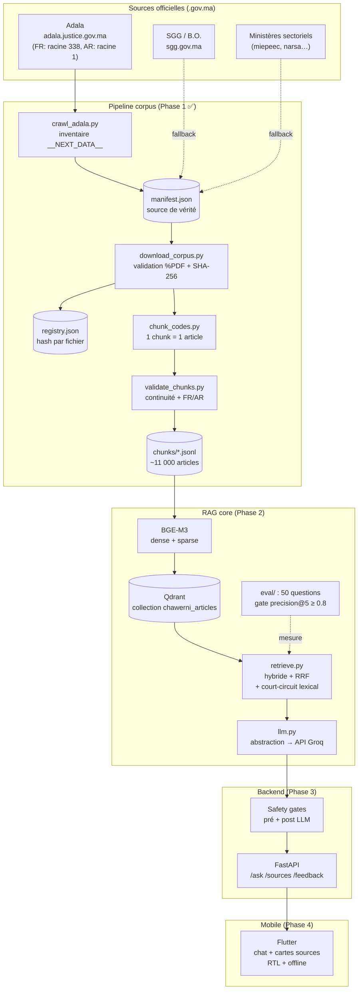
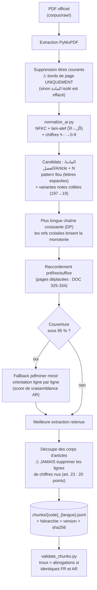
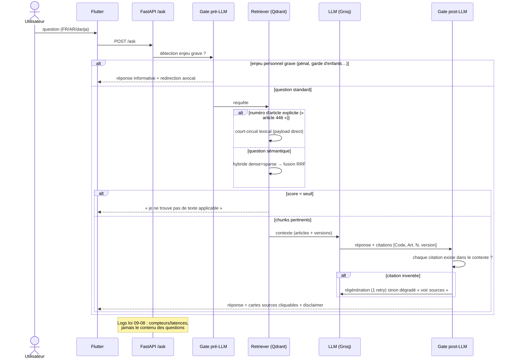
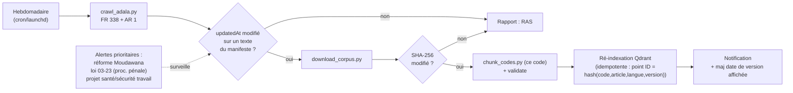
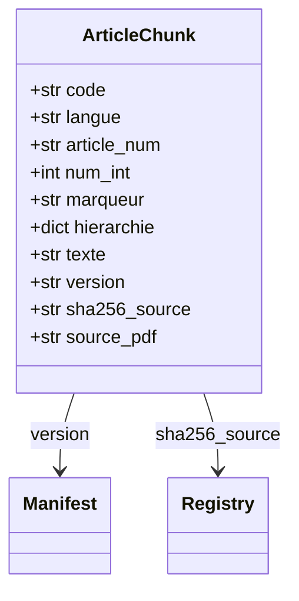

# Architecture Chawerni

Diagrammes Mermaid — rendus nativement par GitHub, VS Code (extension Markdown
Preview Mermaid) et la plupart des viewers Markdown.

## 1. Vue d'ensemble

## 2. Pipeline de chunking (Phase 1b — les pièges résolus)

## 3. Flux d'une question utilisateur (Phases 2-3)

## 4. Veille juridique (Phase 5)

## 5. Modèle de données d'un chunk

| Champ | Exemple | Rôle |
|---|---|---|
| `code` | `code_penal` | clé du manifeste, partout identique |
| `langue` | `ar` / `fr` | filtre de retrieval |
| `article_num` | `446`, `19-1`, `premier` | numéro affiché dans la citation |
| `num_int` | `446` | tri et contrôle de continuité |
| `marqueur` | `المادة` / `الفصل` / `Article` | varie selon le code — piège classique |
| `hierarchie` | `{"الكتاب": …, "الباب": …}` | contexte Livre/Titre/Chapitre |
| `texte` | corps intégral | jamais tronqué par fenêtre de tokens |
| `version` | `2026-04-28` | date de consolidation, affichée dans l'app |
| `sha256_source` | lien `registry.json` | traçabilité veille |

Point d'indexation Qdrant : `ID = hash(code, article_num, langue, version)` —
ré-indexer un code remplace ses points sans toucher au reste.

## 6. Contraintes transverses

| Contrainte | Implémentation |
|---|---|
| Loi 28-08 (exercice du droit) | Gates pré/post + disclaimer systématique + écran 1er lancement |
| Loi 09-08 (données perso) | Logs sans contenu, opt-in collecte, hébergement MA en prod |
| Texte AR fait foi | Réponse cite la version AR ; FR = aide à la lecture |
| Versionnage | `version` affichée dans chaque carte source de l'app |
