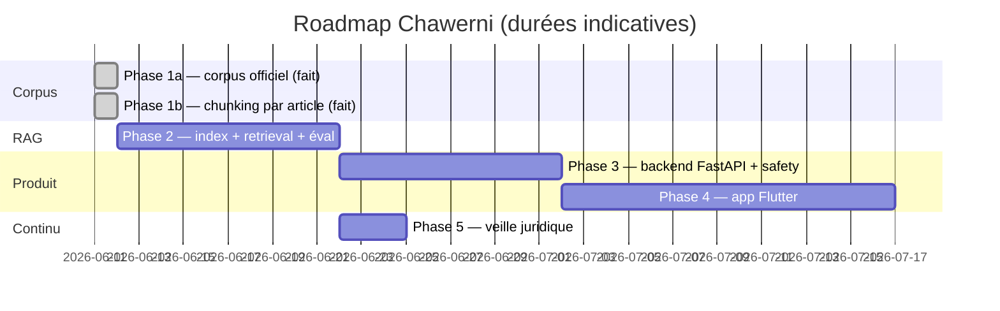

# Plan complet Chawerni — phases, jalons, critères de passage

> Plan approuvé le 2026-06-11. Règle : chaque phase a sa vérification propre ;
> on ne passe pas à la suivante sans elle.

---

## ✅ Phase 1a — Corpus officiel (terminée)

13 textes (10 codes + 3 annexes des livres imprimés équivalents), AR 13/13,
FR 10/13, registre SHA-256, crawler Adala réutilisable.
Trous FR documentés `A_COMPLETER` : code de la route consolidé, loi 38-15
(B.O. traduction officielle), loi 18-12.

## ✅ Phase 1b — Chunking par article (terminée)

**Résultat : 10 973 chunks, validation 0 erreur bloquante, spot-check 12/12.**
Algorithme : plus longue chaîne croissante (DP) + raccordement préfixe/suffixe
+ variantes de numéros (notes collées) + fallback miroir pdfminer.
Pièges documentés dans le README racine, section « Chunking ».

---

## Phase 2 — Indexation et retrieval hybride (~1-2 semaines)

Nouveau dossier `rag/`.

| Fichier | Rôle | Points clés |
|---|---|---|
| `index.py` | chunks → Qdrant | BGE-M3 dense+sparse (FlagEmbedding) ; 1 collection `chawerni_articles`, champ `langue` filtrable ; point ID = hash(code, article, langue, version) → ré-indexation idempotente |
| `retrieve.py` | recherche | hybride + fusion RRF ; **court-circuit lexical** si numéro d'article explicite ; filtres code/langue/version ; score < seuil → liste vide |
| `llm.py` | abstraction LLM | interface `generate()` ; impl. Groq (SDK OpenAI-compatible, `GROQ_API_KEY`) ; changer de fournisseur = 1 classe |
| `prompts.py` | prompt système | rôle information (loi 28-08), citation obligatoire `[Code, Art. N, version]`, refus si contexte vide, réponse dans la langue de la question |
| `eval/` | jeu d'évaluation | 50 questions FR/AR + pièges (n° exact, darija, hors corpus) ; `eval.py` mesure precision@5, recall@5, taux de citation correcte |

**🚧 Gate de passage : precision@5 ≥ 0.8 sur le jeu d'éval, AVANT la Phase 3.**

Vérification : `python3 rag/eval/eval.py` ≥ seuils ; « article 446 du code
pénal » retourne le chunk exact en position 1 ; 5 questions darija manuelles.

Prérequis : `GROQ_API_KEY` (fourni par Abderrahim) ; premier run = ~2,3 Go de
modèle BGE-M3 ; embedding des 11 000 chunks long sur CPU.

## Phase 3 — Backend FastAPI + safety (~1-2 semaines)

Nouveau dossier `backend/`.

- Endpoints : `POST /ask`, `GET /sources/{code}/{article}`, `POST /feedback`,
  `GET /health` ; auth JWT (anonyme possible au MVP).
- **Gates** : pré-LLM (enjeu personnel grave → information + redirection
  professionnel) ; post-LLM (chaque citation vérifiée contre les chunks
  fournis, sinon régénération puis dégradation « voir sources ») ; disclaimer
  systématique.
- Logging loi 09-08 : compteurs/latences seulement, opt-in pour le contenu.
- Dockerfile + docker-compose (API + Qdrant) ; prod marocaine (N+ONE / OCI
  Casablanca) quand il y aura des comptes utilisateurs.

Vérification : pytest (nominal, hors corpus, enjeu grave, citation inventée
simulée) ; `docker compose up` + curl de bout en bout.

## Phase 4 — App mobile Flutter (~2-3 semaines)

Nouveau dossier `app/`.

- Chat + **cartes sources cliquables** (code, n° article, date de version →
  texte intégral).
- Tri-langue FR / AR (RTL natif `Directionality`) / darija ; sélecteur persistant.
- Offline : textes bruts en SQLite (générés depuis `corpus/chunks/`) ; le chat
  exige le réseau.
- Écran disclaimer 1er lancement + « trouver un avocat ».
- Entrée de navigation réservée pour le module « Hoquqi / حقوقي » (post-MVP).

Vérification : simulateurs iOS + Android ; test RTL complet ; mode avion ;
rejouer les 5 questions darija de la Phase 2 depuis l'app.

## Phase 5 — Veille juridique automatisée (continu, ~3 jours de setup)

Nouveau script `corpus/scripts/watch.py`, réutilise tout l'existant :

1. Re-crawl Adala (FR 338, AR 1) → diff `updatedAt` sur les textes du manifeste
2. Re-téléchargement → `⚠️ HASH MODIFIÉ` déclenche re-chunk + ré-indexation
   idempotente + notification
3. Cadence hebdomadaire (cron/launchd local au début)

**Alertes prioritaires** : réforme Moudawana (en cours), loi 03-23 (refonte
procédure pénale), projet de loi santé/sécurité au travail.
Au fil de l'eau : compléter les 3 `A_COMPLETER` FR du manifeste.

---

## Transverse — protection du nom (hors code, en parallèle)

- [ ] OMPIC : recherche « Chawerni » + variantes, classes 9/42/45 ; dépôt
  (~1 000-1 500 DH, protection 10 ans)
- [ ] Domaines : `chawerni.ma` (ANRT) + `.com`
- [ ] Handles : @chawerni sur Instagram, TikTok, LinkedIn
- [ ] Test d'orthographe oral (Chawerni vs Chawarni) sur 3-5 personnes

## Ordre d'exécution

1. ~~Phase 1b~~ ✅ (fondation — garbage in, garbage out)
2. **Phase 2** avec gate chiffré (precision@5 ≥ 0.8) ← **prochaine étape**
3. Phase 3 puis Phase 4 (l'app consomme l'API stabilisée)
4. Phase 5 dès que l'index existe
